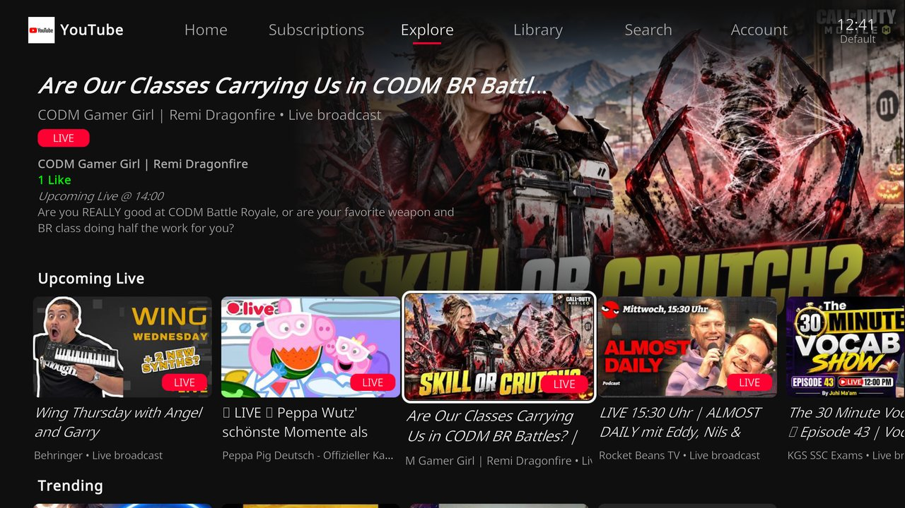
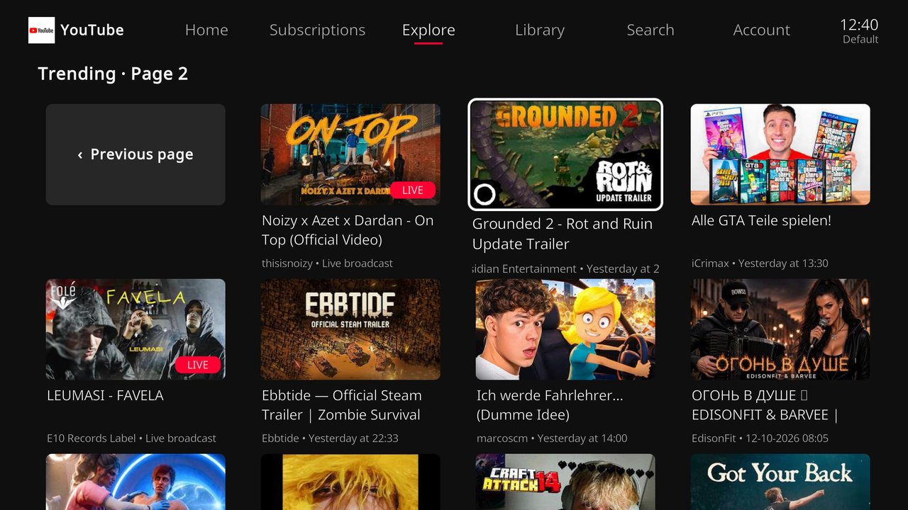
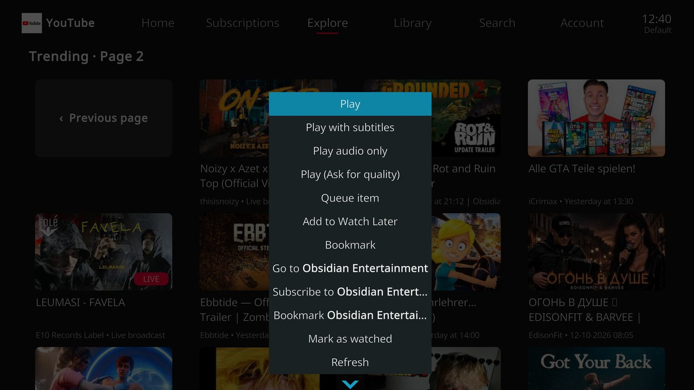

# YouTube for Kodi – TV interface fork

**Deutsch:** Dieser Fork des [YouTube-Addons für Kodi](https://github.com/anxdpanic/plugin.video.youtube)
bringt eine Oberfläche wie die YouTube-App auf Fire TV und Smart-TVs: Tab-Leiste, Reihen mit
Kacheln, große Vorschau des ausgewählten Videos und Seiten mit 100 Kacheln und Scrollbalken, gemacht für die
Fernbedienung. Alle Funktionen des Originals bleiben erhalten, das klassische Menü ist weiterhin
erreichbar. Dazu kommen einige Fehlerbehebungen.

**English:** This fork of the [YouTube add-on for Kodi](https://github.com/anxdpanic/plugin.video.youtube)
adds an interface like the YouTube app on Fire TV and smart TVs: tab bar, rows of tiles, a large
preview of the selected video and grid pages with 100 tiles and a scrollbar, made for remote controls. All
features of the original are kept, the classic menu is still available. It also includes a
number of bug fixes, see [changelog.txt](changelog.txt).

## Screenshots

## Installation

1. Download the ZIP from the [releases](../../releases) of this repository.
2. In Kodi: *Settings → System → Add-ons* → enable *Unknown sources*.
3. *Add-ons → Install from zip file* → select the ZIP.

The TV interface opens when starting the add-on. It can be disabled in the add-on settings
(*General → TV interface*). Kodi may replace this version with an update of the original add-on;
disable automatic updates for the add-on to keep it.

This is an unofficial fork and not endorsed by Google or the original authors.

---

## Links

* [YouTube](http://www.youtube.com)
* [Support thread](https://ytaddon.page.link/forum)
* [Wiki](https://github.com/anxdpanic/plugin.video.youtube/wiki)

---

